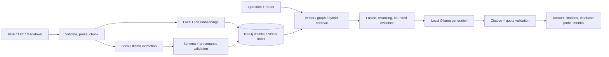

# GraphMind

A fully local GraphRAG application using **Ollama, Neo4j, and hybrid vector–graph retrieval** for explainable multi-hop document questions. The existing React dashboard has seven pages: overview, documents, questions, graph explorer, comparison lab, analytics, and settings.

**Validation status:** non-LLM and mocked-inference validation is documented in [docs/validation.md](docs/validation.md). **Real Ollama extraction, grounded answers, and end-to-end GraphRAG acceptance remain pending.** Do not interpret passing mocked tests or historical demonstration records as live-model validation. Cloud weight downloads were stopped after repeated executor failures; no performance improvement is claimed. The [cloud engineering audit](docs/cloud-audit-report.md) records targeted fixes and remaining risks; [extraction recovery](docs/ollama-extraction-recovery.md) documents the subsequent partial-response fix, current test results and Mac rerun instructions.

Both extraction and answer generation default to **`qwen3:4b`**, sharing one local weight installation. `EXTRACTION_MODEL` and `LLM_MODEL` remain independently configurable, including through installed-model selection in Settings. Gemini, OpenAI, paid inference APIs, API-key requirements, and deterministic production inference are absent.

## Problem and features

A similarity-only retriever can miss facts distributed across documents. GraphMind retrieves source-backed relationships as well as semantically similar chunks, then passes bounded evidence to the same configured answer model used by its vector baseline.

- PDF, TXT, Markdown validation/parsing; background progress, metadata, page tracking, duplicate detection, deletion and reprocessing.
- Local structured LLM entity/relationship extraction, Pydantic validation, normalization, explicit aliases, relationship deduplication, exact source excerpts and document/chunk provenance.
- CPU Sentence Transformers embeddings, Neo4j native vector index, bounded graph traversal and cycle/result limits.
- Standard vector RAG, graph-only retrieval, hybrid fusion/reranking and deterministic automatic routing. No silent benchmark fallback.
- Ollama discovery/health, model availability, configurable context/timeout, retries, streamed progress and JSON-schema outputs.
- Citation IDs and exact quotes are checked against retrieved evidence. Paths originate from Neo4j, never model output.
- Reproducible one-, two-, three-hop and unanswerable benchmark questions, comparison UI, measured analytics, JSON/CSV exports.

Synthetic facts in `datasets/demo` form:

```text
Rahul Sharma —FOUNDED→ AlphaTech —ACQUIRED→ DataVision —PARTNERED_WITH→ MedCore
```

The expected three-hop answer is **MedCore**. This is a reference answer, not a claim that the local model has passed the task. Vector RAG can also answer correctly if it retrieves all required chunks.

## Architecture and stack



Frontend: React, TypeScript, Vite, Tailwind, shadcn-style components, Lucide, Router, TanStack Query, Cytoscape, Recharts and Framer Motion. Backend: Python 3.11+, FastAPI, Pydantic, Uvicorn, Neo4j driver/GraphRAG index helpers, Sentence Transformers, PyMuPDF and SQLite WAL metadata. Infrastructure: Docker Compose, Pytest and GitHub Actions.

Business logic is separated into `backend/{ingestion,knowledge_graph,embeddings,retrieval,reasoning,evaluation}`; routes live in `backend/api`. Frontend code is under `frontend/src`. See [architecture](docs/architecture.md) and [security](docs/security.md).

## Run locally

See [exact macOS setup and real acceptance commands](docs/macos-local-acceptance.md). You need Docker Desktop, native Ollama and a manually installed `qwen3:4b` model. No Ollama cloud account is required. A 16 GB Apple Silicon machine is recommended; allow roughly 10 GB spare disk for weights, images and caches. Context length/quantization affect memory. Native Ollama uses Apple acceleration; no dedicated GPU is required. Mac performance has not been measured here.

After installing dependencies and Ollama:

```bash
uv sync --python 3.12 --frozen --extra dev
.venv/bin/python scripts/init_env.py
ollama pull qwen3:4b
# Configure Ollama host access as described in the macOS guide.
docker compose up --build -d
```

`init_env.py` creates `.env` with a random local Neo4j password only if it does not exist. Never commit `.env`. Dashboard: port 3000; API: 8000; Neo4j Browser/Bolt: 7474/7687. Ports bind to loopback. API docs: `/api/docs`; OpenAPI: `/api/openapi.json`.

Compose points FastAPI at native host Ollama using `http://host.docker.internal:11434` and a Linux host-gateway mapping. Native backend development uses `http://localhost:11434`. The app never pulls Ollama weights automatically. `/api/health` reports degraded/503 until Neo4j, embeddings, and selected local models are ready; the dashboard stays available for diagnostics.

For native frontend/backend development, use Python 3.12, Node >=22.12 and pinned uv 0.12.23, run `npm --prefix frontend ci`, start only Compose Neo4j, then run `.venv/bin/uvicorn backend.api.main:app` and `npm --prefix frontend run dev` in separate terminals. Do not run two backends against the same control store.

The embedding model downloads once into `.data/models`; inference then runs locally. To work offline, pre-cache dependencies/images/weights and set `HF_HUB_OFFLINE=1` and `TRANSFORMERS_OFFLINE=1`. In the managed proxy environment use `docker-compose.cloud.yml` to retain CA trust. Large model downloads are intentionally disabled as an execution strategy in this unstable cloud instance.

## Configuration

| Variable | Default / purpose |
|---|---|
| `LLM_PROVIDER` | `ollama` only |
| `LLM_MODEL` | `qwen3:4b`, answer generation |
| `EXTRACTION_MODEL` | `qwen3:4b`, entity/relationship extraction |
| `OLLAMA_BASE_URL` | Native localhost; Compose host gateway |
| `OLLAMA_CONTEXT_LENGTH` | 16384 |
| `OLLAMA_KEEP_ALIVE` | 0; unload after each serialized inference |
| `REQUEST_TIMEOUT` / `MAX_OUTPUT_TOKENS` | 180 seconds / 4096 |
| `EMBEDDING_MODEL` | CPU all-MiniLM-L6-v2, 384 dimensions |
| `TOP_K` / `MAX_DEPTH` | 8 chunks / 3 hops (depth capped at 5) |
| `SIMILARITY_THRESHOLD` | 0.15 |
| `CHUNK_SIZE` / `CHUNK_OVERLAP` | 1200 / 150 characters |
| `CONTEXT_TOKENS` | 6000 conservative UTF-8 byte budget including prompt reservations |
| `NEO4J_*` | Server connection and server-only password |

Settings persist in SQLite and apply to future requests/jobs. Changing extraction settings does not reprocess documents automatically. Cached validated extractions include text, model tag, relationship vocabulary, context and prompt version; changing weights under the same tag requires explicit cache invalidation. Failed extraction is not cached. No secrets are returned to the browser.

## Graph, retrieval and grounding

Schema: `(:Document)-[:HAS_CHUNK]->(:Chunk)-[:MENTIONS]->(:Entity)`. Semantic edges are `(:Entity)-[:FACT {type,evidence,chunk_id,document_id,confidence}]->(:Entity)`. IDs are constrained; Cypher values are parameterized. Model output cannot choose executable Cypher.

Entity identity uses exact normalized type/name, with Company normalized to Organization; similar names are never fuzzy-merged. Explicit aliases help linking without merging ambiguous identities. Every edge retains source evidence. Graph expansion bounds depth/frontier/adjacency/results and forbids repeated nodes.

Vector mode never traverses the graph; graph mode never embeds the query. Hybrid deduplicates chunks, combines rankings with weighted reciprocal rank fusion or weighted scores, optionally reranks lexically, and selects whole evidence/path units within budget. No path is returned without all its supporting chunks.

Ollama receives untrusted document text under a system grounding policy and a structured JSON schema. Streamed draft tokens are buffered; the browser sees progress followed by the citation-checked answer. Invalid attributions are removed. Insufficient evidence returns: “The uploaded documents do not contain enough information to answer this question reliably.” Quote validation checks attribution, not semantic entailment. Prompt injection and model errors remain possible.

## APIs

- Health: `/api/health`; Ollama status/models: `/api/ollama/status`, `/api/ollama/models`.
- Documents: upload/list/detail/status/source/delete/reprocess under `/api/documents`.
- Questions: `POST /api/query`, `/api/query/stream`, `/api/query/compare`; history `/api/queries`.
- Graph: stats/entities/neighbors/subgraph/traverse under `/api/graph`.
- Evaluation: run/results/summary and result exports under `/api/evaluation`.
- Analytics: overview/latency/retrieval. Settings: GET/PATCH `/api/settings`.

## Tests and benchmarks

```bash
bash scripts/check.sh
```

This runs backend unit/API/protocol tests (external inference mocked), frontend tests, TypeScript and the frontend production build. Isolated real Neo4j plumbing tests and seven-page browser checks also use explicit inference doubles; see [validation](docs/validation.md). No test double is selectable in production.

[Local acceptance instructions](docs/macos-local-acceptance.md) cover actual model schema support, uploaded-document extraction, one-/two-/three-hop paths, citations and comparison. `docker-compose.acceptance.yml` isolates control data and Neo4j volumes while sharing cached embeddings. Live commands are provided but have **not passed in this cloud environment**.

The synthetic benchmark uses the same answer model/configuration for vector and hybrid calls. It records normalized reference containment (an accuracy proxy), expected evidence recall, source relevance, directed graph correctness, latency and Ollama token counts. API cost is zero and excludes electricity/hardware. Missing measurements remain unavailable; failed calls remain failed. Exported runs include settings/model/dataset/timestamp provenance. Do not claim superiority from the tiny corpus or unexecuted live experiments.

## Persistence, troubleshooting and limitations

Back up Neo4j named volumes and `.data` together: `.data` contains SQLite, original uploads and cache. `docker compose down` retains named volumes; avoid `down -v` for persisted work. Reprocessing can invalidate old response/evaluation snapshots; use the isolated acceptance stack instead. Existing development documents and historical evaluations are preserved with their original provenance.

- **Ollama unavailable:** start it; check `/api/tags` from the backend network. Docker localhost is its own container; use the host gateway and the documented host bind/firewall configuration.
- **Missing model:** manually install the tag or select an installed local model. No cloud entry, auto-pull or fallback is used.
- **Readiness after restart:** failed schema startup is retried on health/API checks with a 15-second cooldown and a single initialization lock. Wait for Neo4j and check readiness again. Do not reset data/passwords.
- **Stale proxy after cloud recovery:** inspect current proxy/CA readiness and recreate only affected runtime containers with preserved mounts. Do not retry large downloads or bypass denied destinations.
- **OOM/slow inference:** lower context or choose a smaller installed model. Requests serialize and unload by default, trading latency for RAM.
- **Malformed JSON/extraction:** unusable response/entity data fails visibly. Invalid individual relationships are discarded with document metadata/UI warnings while valid facts are retained. A ready document can still have incomplete graph coverage. See the extraction recovery guide; no missing edge is invented.
- **No answer/path:** inspect real extracted facts, exact entity names, threshold/depth and evidence budget. OCR and automatic identity disambiguation are out of scope.

This local research application has no built-in user authentication or distributed job queue. Add an authenticated gateway for network deployment. Never expose Ollama/Neo4j publicly. `.gitignore` excludes secrets, stores, weights and temporary outputs. Future work includes entailment evaluation, larger annotated datasets, OCR, local cross-encoder reranking and durable scheduling. All live-model quality and Apple Silicon performance claims remain pending until measured.
