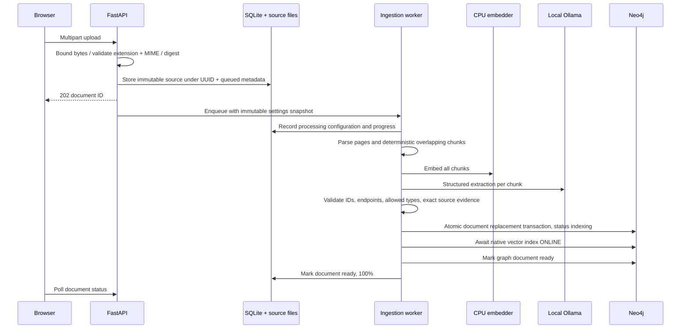

# Architecture and invariants

## Boundaries

The backend owns all secrets, parsing, embeddings, graph access, retrieval, generation, and evaluation. The browser cannot execute Cypher, set provider URLs, or read passwords. SQLite is a durable local control plane; Neo4j holds evidence and embeddings. All frontend metrics are computed by backend queries; empty metrics remain empty.

A failed extraction fails the job and retains its source and safe error metadata. Reprocessing checks model readiness, retains the prior graph until validated replacement, and removes stale response snapshots only after successful replacement. A crash during processing is recorded as interrupted on restart; it never automatically retries inference. One background worker serializes ingestion to avoid duplicate/racing document writes. Jobs are durable in metadata but the execution queue is in-process; scale requires an external job system.

## Identity and provenance

Document UUID is independent of user-controlled filenames. Duplicate bytes are detected by SHA-256. Chunk IDs derive from document ID, position, and normalized content. Entity IDs are a hash of Unicode NFKC/casefold/whitespace-normalized **type:name**. No fuzzy similarity merges entities. Aliases are explicit source mentions, tracked on `MENTIONS`; removal recomputes surviving aliases. They resolve query mentions but do not merge two entities.

Relationship identity derives from source entity, semantic type, target entity, and source chunk. `FACT` is the only dynamically traversed graph relationship label. The semantic type is a validated property, not executable Cypher syntax. Every edge references a real chunk and document and retains its exact excerpt and ingestion timestamp. Database uniqueness constraints guard IDs, and ingestion uses `MERGE` for stable relationship identity.

## Retrieval and bounded work

Vector queries use `db.index.vector.queryNodes`. Index construction uses the installed `neo4j_graphrag.indexes.create_vector_index` API. Model name/dimension are stored as a database singleton: mismatches fail startup.

Entity candidates are selected by exact names/aliases contained in the question (at most 200), then checked with word boundaries and limited to 10 seeds. Graph expansion is iterative: depth <=5, frontier <=100, each adjacency request bounded, repeated nodes forbidden, and seen relationship sequences deduplicated. Edges from documents not marked ready are excluded. The ranking favors validated confidence, query relationship overlap, and longer connected evidence. Bounded expansion is incomplete on high-degree graphs; this is explicit.

Graph chunks and vector chunks fuse by stable chunk ID. RRF uses `weight/(60+rank)`. Weighted fusion combines native vector similarity and reciprocal graph evidence rank; those score scales are heuristic. Optional lexical reranking blends fused order with query term overlap. A conservative UTF-8 byte count reserves prompt/schema/question overhead before selecting whole evidence items and database paths. This overestimates token usage and can discard useful context, but avoids claiming exact tokenizer counts. No displayed path survives without every supporting chunk.

## Generation

Live providers receive a system policy and JSON-encoded untrusted evidence. A structured answer contains supported claims, citation IDs, and exact supporting quotes. IDs must belong to retrieved context; every cited ID needs an exact excerpt; extraneous/invalid claims are removed. This checks attribution, not entailment. The refusal is constant and explicit. API paths are attached by the retrieval service, never by model output.

Ollama is the sole runtime provider. Extraction and answer models are selected separately. The backend checks installed local models, excludes cloud entries, uses structured streamed JSON with thinking disabled, and serializes inference through a process-wide lock. Default keep-alive zero unloads weights after each call. Only progress events and the validated final answer reach the browser. There is no automatic pull or fallback generator. Deterministic doubles exist only under `backend/tests`.

Validated extraction caches are keyed by text, model tag, relationship vocabulary, context and prompt version. Cache payloads use chunk-local references; document/chunk provenance is attached during persistence. Invalid results are not cached. A model tag whose weights change needs explicit cache invalidation.

## Lifecycle and persistence

SQLite uses WAL and per-operation connections. Query snapshots, settings, and evaluation records persist. Document deletion removes Neo4j facts/chunks/vectors, orphan entities, source files, and query/evaluation snapshots containing removed evidence. Back up graph and control data together. No cross-database atomic commit is possible; transient startup/index failures are surfaced, not hidden. Production entrypoint: `backend.api.main:app`; fixture entrypoint exists only under `backend/tests`.
